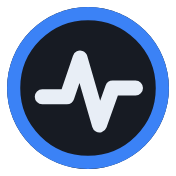
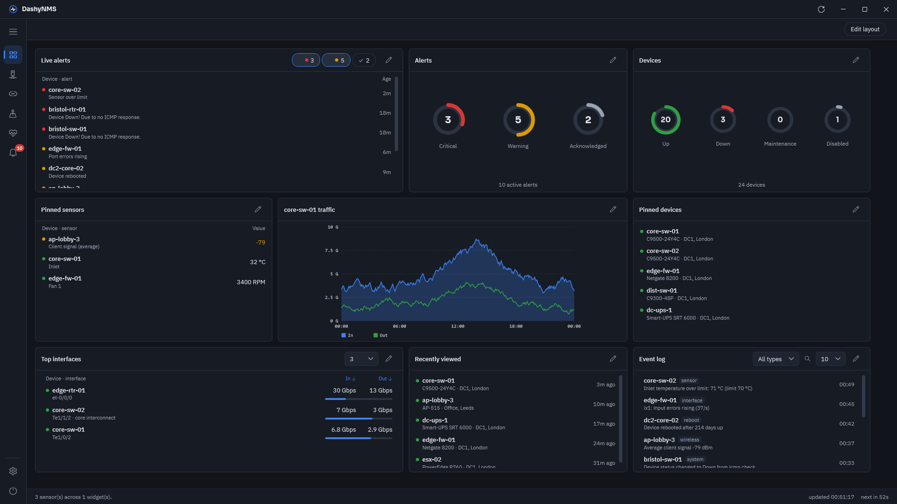
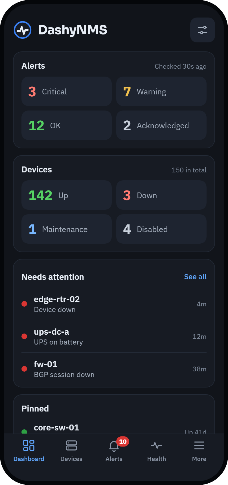

  

<h1 align="center">DashyNMS</h1>

  <strong>Your LibreNMS, wherever you are.</strong> 
  Know the moment something breaks, and deal with it from your desk or your pocket.

  <a href="https://dashynms.pckp.net/">Website</a> ·
  <a href="https://github.com/DashyNMS/desktop/releases">Download for Windows</a> ·
  <a href="https://dashynms.pckp.net/mobile/">Mobile</a> ·
  <a href="https://dashynms.pckp.net/desktop/support/">Support</a>

---

DashyNMS brings your [LibreNMS](https://www.librenms.org/) server to your Windows desktop and your phone. Sign in with an API token and it watches your network for you: what's down, what's alerting and why, without keeping a browser tab open.

<table>
  <tr>
    <td width="50%" valign="top">
      <h3>🖥️ <a href="https://github.com/DashyNMS/desktop">DashyNMS Desktop</a></h3>
      
Lives in your Windows tray, polls in the background and raises a notification when something changes. A full desktop UI for devices, alerts, alert rules, health and graphs.

      

        <a href="https://github.com/DashyNMS/desktop/releases"><b>Download</b></a> ·
        <a href="https://dashynms.pckp.net/desktop/">Learn more</a> ·
        <a href="https://dashynms.pckp.net/desktop/releases/">Release notes</a>
      

    </td>
    <td width="50%" valign="top">
      <h3>📱 <a href="https://github.com/DashyNMS/mobile">DashyNMS Mobile</a></h3>
      
Your network in your pocket. Alert notifications, home and lock screen widgets, and every device one tap away, for when you're on call or on site.

      

        <b>iPhone &amp; iPad:</b> coming soon ·
        <b>Android:</b> later 
        <a href="https://dashynms.pckp.net/mobile/">Learn more</a>
      

    </td>
  </tr>
  <tr>
    <td width="50%" align="center">
      
    </td>
    <td width="50%" align="center">
      
    </td>
  </tr>
  <tr>
    <td colspan="2" valign="top">
      <h3>🤖 <a href="https://github.com/DashyNMS/mcp">DashyNMS MCP</a></h3>
      
Ask Claude, or any other MCP client, about your network: "what's alerting?", "how is this switch doing?", "what changed on it since yesterday?". It only reads, and it redacts secrets before anything reaches the model. Runs from a small container image.

      

        <a href="https://github.com/DashyNMS/mcp#readme"><b>Learn more</b></a> ·
        <a href="https://github.com/DashyNMS/mcp/pkgs/container/mcp">Container image</a> ·
        <b>Status:</b> early
      

    </td>
  </tr>
</table>

## Private by design

- **Talks only to your server.** Nothing goes anywhere except your own LibreNMS instance.
- **No account, no analytics, no tracking.** There's nothing to sign up for.
- **Your token stays yours.** Encrypted for your Windows account on desktop, kept in the keychain on mobile.

## Repositories

| Repository | What's in it |
| --- | --- |
| [**desktop**](https://github.com/DashyNMS/desktop) | The Windows app (.NET), installer and docs |
| [**mobile**](https://github.com/DashyNMS/mobile) | The iPhone and iPad app, with widgets |
| [**mcp**](https://github.com/DashyNMS/mcp) | The read-only MCP server for AI assistants (.NET), and its container image |
| [**website**](https://github.com/DashyNMS/website) | Source for [dashynms.pckp.net](https://dashynms.pckp.net/) |

## Get involved

Found a bug or have an idea? Open an issue on the [desktop](https://github.com/DashyNMS/desktop/issues), [mobile](https://github.com/DashyNMS/mobile/issues) or [mcp](https://github.com/DashyNMS/mcp/issues) repository. Want to contribute to the desktop app? Start with the [contributing guide](https://github.com/DashyNMS/desktop/blob/master/CONTRIBUTING.md).

DashyNMS is an independent project and isn't affiliated with or endorsed by LibreNMS.
